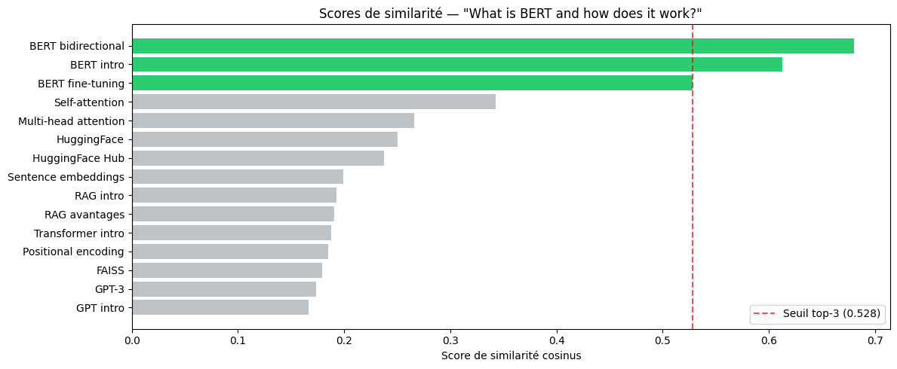

# NLP avec les Transformers & Système RAG

Mini-projet NLP réalisé dans le cadre du cycle ingénieur en Ingénierie des Données (ENSA Al Hoceima).
Il comprend deux parties : une exploration des modèles Transformers pré-entraînés sur plusieurs tâches NLP, puis l'implémentation d'un système **RAG (Retrieval-Augmented Generation)** de questions-réponses.

---

## Partie 1 — Exploration des Transformers (`Partie1_NLP_Transformers.ipynb`)

| Tâche | Modèle | Dataset d'entraînement |
|---|---|---|
| Tokenization | `bert-base-uncased` | Wikipedia + BookCorpus |
| Classification de texte | BERT fine-tuné | AG News |
| Analyse de sentiment (binaire) | DistilBERT | SST-2 |
| Analyse de sentiment (3 classes) | RoBERTa | Twitter |
| Question Answering extractif | DistilBERT | SQuAD v1.1 |
| Résumé automatique | DistilBART, T5-small | CNN/DailyMail |
| Classification zero-shot | BART-large | MNLI |

Chaque tâche est réalisée de deux façons : via `pipeline()` (HuggingFace), puis via `AutoTokenizer` + `AutoModel` pour accéder aux logits et comprendre le fonctionnement interne.

---

## Partie 2 — Système RAG (`Partie2_Systeme_RAG.ipynb`)

### Architecture

```
Indexation : Documents → Embeddings (all-MiniLM-L6-v2) → Index FAISS
Requête    : Question → Embedding → Recherche top-k → Prompt augmenté → FLAN-T5 → Réponse
```

| Composant | Outil | Rôle |
|---|---|---|
| Base de connaissances | Corpus de 15 documents (Transformers, BERT, GPT, RAG, FAISS) | Source des réponses |
| Embeddings | `all-MiniLM-L6-v2` (sentence-transformers, 384 dimensions) | Encodage vectoriel |
| Index vectoriel | FAISS `IndexFlatIP` + normalisation L2 | Recherche par similarité cosinus |
| Générateur | `google/flan-t5-base` | Génération de la réponse |

### Résultats : avec RAG vs sans RAG

| Question | Sans RAG | Avec RAG |
|---|---|---|
| How many parameters does BERT-base have? | four | **110 million** |
| What library does HuggingFace provide for NLP? | NLP Library | **Transformers** |
| What is the dimension of embeddings from all-MiniLM-L6-v2? | 4 x 4 mm | **384** |

Sans contexte, le modèle hallucine ; avec les documents récupérés, il donne la bonne réponse et chaque réponse est traçable jusqu'à ses sources.

### Scores de similarité du retriever



Pour la question *« What is BERT and how does it work? »*, les trois documents sur BERT sont correctement classés en tête (score cosinus > 0,52), loin devant les autres.

### Limites observées et améliorations possibles

- FLAN-T5-base produit des réponses **courtes** et parfois incomplètes.
- Le retriever classe parfois un document moins pertinent en premier (ex. : document GPT pour la question sur l'origine du Transformer).
- Pistes : chunking de documents longs, **re-ranking** avec un cross-encoder, **recherche hybride** (FAISS + BM25), LLM plus puissant (Mistral, Llama), évaluation quantitative du retrieval (recall@k).

---

## Lancer le projet

```bash
pip install -r requirements.txt
jupyter notebook
```

Ou ouvrir les notebooks dans Google Colab. Les modèles sont téléchargés automatiquement depuis le HuggingFace Hub.

## Technologies

Python · PyTorch · HuggingFace Transformers · sentence-transformers · FAISS · Matplotlib

## Auteure

**Nassima Maarouf** — Élève ingénieure en Ingénierie des Données, ENSA Al Hoceima
[LinkedIn](https://www.linkedin.com/in/nassima-maarouf-48521132a/) · [GitHub](https://github.com/N-creator-M)
